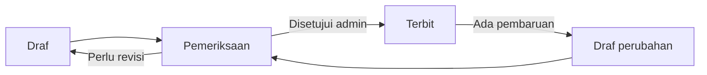

# Rancangan Sistem Admin dan AI Jejakarsa

**18 November 2026 · Acuan desain sebelum implementasi**

Jejakarsa perlu satu ruang kerja untuk mengelola dua jenis konten. **Kisah Juara** membutuhkan editor yang sederhana untuk menerbitkan hasil wawancara. **Cari Lomba** membutuhkan cara yang cepat untuk memasukkan informasi dari sumber resmi, dengan bukti yang bisa diperiksa sebelum data dipakai oleh katalog dan rekomendasi. Kedua alur memakai akses admin dan penyimpanan terpusat. Rancangan ini menjadikan tampilan publik yang sudah disetujui sebagai acuan.

## 1. Fungsi tiga file yang sudah ada

| File | Fungsi sekarang | Perannya dalam rancangan |
|---|---|---|
| `lib/stories.ts` | Mendefinisikan tipe `WinnerStory`, menyimpan cerita contoh, dan menyediakan fungsi untuk mengambil cerita publik, memilih cerita unggulan, dan memakai judul pendek pada kartu. `getPublicStories()` menampilkan cerita nyata jika statusnya `published`, pencapaian sudah diperiksa, dan narasumber mengizinkan publikasi. Cerita simulasi adalah cadangan selama mode contoh aktif dan belum ada cerita nyata yang memenuhi kondisi itu. | Pertahankan bentuk data yang dibutuhkan halaman publik. Pindahkan isi cerita nyata ke database dan terapkan pemeriksaan yang sama di server ketika sebuah versi diterbitkan. |
| `lib/eligibility.ts` | Membandingkan syarat lomba dengan profil pengguna lewat `assessEligibility()`. Ia memeriksa bidang yang sudah didukung, seperti jenjang, prodi, kesiapan tim, dan biaya. Bukti yang belum terverifikasi menghasilkan kondisi belum diketahui. Anggaran dan kesiapan tim diperlakukan sebagai pertimbangan pengguna. File ini juga memformat tanggal dan biaya. | Mesin aturan ini tetap menjalankan penilaian. AI membantu menemukan nilai dan bukti dari sumber, lalu admin menetapkan nilai mana yang dapat digunakan mesin. |
| `app/admin/review/page.tsx` | Halaman **Kurasi Data** di `/admin/review`. Halaman membaca lomba contoh dan menampilkan status sumber serta bukti. Tombol **Tandai diperiksa** menyimpan waktu pemeriksaan di `localStorage` browser yang dipakai. | Jadikan halaman ini titik masuk untuk daftar kandidat, draf, dan perubahan lomba yang perlu diperiksa. Saat data sudah nyata, simpan pemeriksaan dan persetujuan di server. |

File `page.tsx` di atas adalah **halaman admin**, karena letaknya di `app/admin/review/`. Jejakarsa punya beberapa file dengan nama yang sama di folder rute lain. Tiga file tersebut memperlihatkan aturan dan tampilan prototipe. Pada versi yang ditinjau, belum ada layanan AI yang memproses data di ketiga file itu.

Ada batas yang perlu dijaga saat beralih ke data nyata. Pemeriksaan prodi saat ini memakai kata kunci umum seperti *teknik* dan *teknologi*. Syarat spesifik seperti “khusus mahasiswa Teknik Kimia semester 5–7” belum dapat disimpulkan dari aturan itu. Tampilkan syaratnya dan beri status **Perlu pemeriksaan** sampai jenis aturan tersebut ditangani dengan data profil yang memadai. Demikian juga, biaya di format publik sekarang berasumsi rupiah. Lomba dengan biaya dalam mata uang lain perlu penyesuaian tampilan dan pembandingan sebelum fitur penilaian anggaran dipakai untuk lomba tersebut.

## 2. Struktur ruang kerja admin

Pertahankan `/admin/review` sebagai pintu masuk. Setelah masuk, admin melihat dua area dengan tugas yang jelas.

| Area | Tugas pertama yang terlihat | Informasi yang ditampilkan |
|---|---|---|
| Cari Lomba | **Tambah lomba** atau lanjut periksa draf | Sumber asli, waktu pemeriksaan terakhir, tenggat, dan kolom penting yang belum tuntas. |
| Kisah Juara | **Buat draf cerita** atau lanjut sunting | Narasumber, lomba, pencapaian, status izin, dan pratinjau artikel. |

Satu akun admin cukup untuk tahap awal. Login dan pemeriksaan hak akses dilakukan di server pada halaman, pembacaan draf, unggah file, dan tindakan yang mengubah data. Menyembunyikan tautan dari menu memengaruhi navigasi saja. Untuk akses dan operasi sensitif, gunakan pemeriksaan sesi pada lapisan akses data dan tiap titik masuk server yang relevan. [Panduan autentikasi Next.js](https://nextjs.org/docs/app/guides/authentication)

Status publikasi, status bukti, dan status pekerjaan AI perlu punya fungsi masing-masing. Sebuah lomba bisa **Terbit** dan memiliki **Draf perubahan** jika ada pengumuman baru. Sebuah kolom di draf bisa **Perlu klarifikasi** walaupun pembacaan AI sudah **Selesai**. Di daftar admin, tampilkan satu status utama beserta alasan yang bisa ditindaklanjuti, misalnya **Perlu diperiksa · Ada dua tenggat**. Detail status tersedia saat draf dibuka.

Selama draf perubahan diperiksa, halaman publik membaca versi terbit terakhir. Persetujuan menetapkan satu versi sebagai versi publik dalam satu operasi agar publikasi dan catatan riwayat tetap selaras.

## 3. Kisah Juara — editor unggah, draf dibantu AI eksternal

### Alur kerja

1. **Catat usulan.** Untuk tahap awal, admin dapat memakai kiriman yang sudah masuk melalui Bagikan Prestasi atau memasukkan hasil komunikasi sendiri. Pada versi yang ditinjau, halaman Bagikan Prestasi menautkan formulir perorangan dan mitra ketika alamatnya dikonfigurasi. Kiriman dari formulir belum otomatis menjadi draf redaksi. Status akses penanggung jawab mitra perlu diatur di penyedia formulir jika aksesnya memang dibatasi.
2. **Wawancarai narasumber.** Catat kejadian, pilihan yang mereka ambil, hasilnya, dan kutipan yang layak dipakai. Simpan rujukan ke rekaman atau catatan agar detail penting bisa ditemukan lagi. Bukti pencapaian dan izin publikasi dicatat terpisah.
3. **Susun draf dengan AI eksternal.** Beri model catatan yang relevan untuk penulisan dan pedoman editorial Jejakarsa. Minta detail merujuk pada catatan, tandai informasi yang perlu dikonfirmasi, dan pakai tanda kutip hanya untuk ucapan yang tersedia secara verbatim. Detail kontak dan dokumen bukti internal cukup diakses redaksi.
4. **Tempel dan rapikan di editor.** Isi metadata, ubah urutan bagian artikel sesuai ceritanya, unggah foto, dan periksa hasil di pratinjau desktop dan HP. Simpan draf kapan saja meski masih ada informasi yang belum lengkap.
5. **Periksa dan terbitkan.** Admin mencatat bahwa pencapaian sudah diperiksa dan narasumber sudah memberi izin untuk versi yang akan tayang. Jika perubahan berikutnya menyangkut kutipan, foto, atau klaim pencapaian, periksa kembali bagian yang berubah sebelum versi baru diterbitkan.

### Bentuk editor

- **Identitas cerita** memuat judul artikel, judul pendek untuk kartu bila diperlukan, ringkasan singkat, nama narasumber atau tim, kampus, lomba, pencapaian, tahun, dan foto sampul beserta keterangannya.
- **Isi artikel** terdiri dari paragraf, subjudul, kutipan, foto dengan keterangan, dan daftar. Susun sebagai blok yang dapat diurutkan. Tahap awal bisa memakai editor teks dengan pilihan blok sederhana. Tabel cocok untuk membandingkan beberapa percobaan atau menyajikan linimasa. Tambahkan setelah ada artikel nyata yang memerlukannya.
- **Kredit dan bukti** membedakan kredit publik dari catatan internal. Nama himpunan atau fakultas bisa mendapat kredit sebagai pemberi data jika perannya jelas. Kontak, catatan wawancara, dokumen bukti, dan catatan izin tetap berada di ruang kerja redaksi.
- **Pratinjau** memakai komponen halaman publik yang sama. Admin dapat melihat panjang judul pada kartu, posisi foto sampul, dan alur artikel sebelum menerbitkan.

Pedoman prompt menetapkan cara menulis dan memeriksa fakta, sementara susunan artikel mengikuti cerita. Tim yang menguji tiga prototipe bisa memakai urutan percobaan dan foto. Cerita tentang menyusun argumen menjelang final bisa memakai satu narasi dengan dua kutipan. Kedua artikel tetap punya kartu dan identitas yang konsisten. Model di dalam aplikasi kelak boleh dipilih berdasarkan hasil uji kualitas, biaya, dan kemudahan kerja. Editor manual memberi alur yang bisa dipakai sekarang sambil ukuran pekerjaan redaksi diamati.

## 4. Cari Lomba — temuan, bukti, dan keputusan terbit

### A. Masukkan kandidat

Mulai dengan tombol **Tambah lomba** yang menerima tautan resmi, tautan postingan, atau data awal yang ditulis admin. Kolom kandidat cukup berupa nama sementara, penyelenggara jika diketahui, tautan, dan catatan. Admin dapat menambahkan PDF, poster, atau caption setelah memastikan sumbernya. Lomba yang hanya diumumkan melalui media sosial tetap bisa diproses bila postingan berasal dari penyelenggara dan informasinya cukup jelas.

Pencarian web otomatis dapat mengisi antrean yang sama setelah alur manual berjalan. Mulai dari daftar situs kampus, penyelenggara, dan instansi yang konsisten mengumumkan lomba. Untuk Instagram, pertahankan jalur tempel tautan karena pencarian API resminya terbatas pada akses tertentu, seperti media bertagar dan informasi akun profesional. Ketika isi postingan tidak bisa dibaca melalui akses yang tersedia, admin bisa memasukkan caption atau poster. [Dokumentasi API Instagram dari Meta](https://www.postman.com/meta/instagram/documentation/6yqw8pt/instagram-api)

### B. Tentukan apakah kandidat adalah lomba yang sudah tercatat

Periksa duplikat di database sebelum memanggil model untuk analisis dokumen. Sistem menyimpan tautan yang diseragamkan, identitas penyelenggara, nama lomba, dan edisi atau tahun. Parameter tautan yang membedakan edisi atau halaman pendaftaran tetap dipertahankan. Nama yang mirip cukup menjadi petunjuk untuk diperiksa admin.

| Temuan | Perlakuan |
|---|---|
| Dokumen dengan sidik jari file yang sama sudah diproses dan format ekstraksinya masih sesuai | Pakai hasil sebelumnya jika sumber itu sudah dikaitkan dengan lomba yang tepat. |
| Nama, penyelenggara, dan edisi sama, ada poster atau PDF berbeda | Tautkan sebagai sumber baru. Bandingkan dengan versi terbit dan buka draf perubahan bila diperlukan. |
| Nama sama dan penyelenggara berbeda, atau edisi berbeda | Pertahankan kandidat terpisah setelah identitas diperiksa. |
| Edisi atau penyelenggara belum jelas | Tampilkan kemungkinan duplikat. Admin bisa mengaitkan, memisahkan, atau menunda. |

Pencarian dapat menemukan sumber yang sama berulang kali. Penghematan terbesar datang dari mencegah analisis ulang atau draf ganda. Simpan kunci analisis dari sidik jari dokumen dan versi skema atau konfigurasi ekstraksi. Pengulangan permintaan yang sama dapat memakai hasil lama. Admin tetap bisa meminta analisis baru secara sengaja jika dokumen berubah atau ekstraksi perlu diperbaiki.

### C. Baca sumber dan isi draf

Admin menekan **Baca panduan** untuk memulai proses. Program mengambil teks beserta nomor halaman dari PDF. Untuk hasil pindai atau tabel yang sulit dibaca, gunakan pembacaan visual sesuai kebutuhan atau minta admin mengisi bagian tersebut. Catat versi dokumen dan bedakan nomor halaman fisik file dari nomor cetak ketika berbeda. API yang menerima PDF secara langsung dapat memasukkan teks dan gambar halaman ke konteks, sehingga cara pengiriman dokumen ikut memengaruhi biaya. [Dokumentasi input file OpenAI](https://developers.openai.com/api/docs/guides/file-inputs)

Minta AI mengembalikan **usulan nilai per kolom**. Setiap usulan memuat nilai, pengenal sumber, halaman atau bagian, dan kutipan singkat. Jika ada beberapa versi, tampilkan masing-masing beserta sumbernya. Format terstruktur memudahkan hasil dipasang ke formulir, sementara nilai dan kutipannya tetap perlu diperiksa. Pada tampilan admin, letakkan nilai yang bisa diedit di sebelah bukti. Di HP, bukti bisa dibuka tepat di bawah kolomnya. [Dokumentasi keluaran terstruktur OpenAI](https://developers.openai.com/api/docs/guides/structured-outputs)

| Data | Cara menyimpannya |
|---|---|
| Identitas | Nama lomba, penyelenggara, edisi, bidang, dan tautan pengumuman resmi. |
| Pendaftaran | Tanggal tenggat, jam dan zona waktu bila tercantum, gelombang atau jalur bila relevan, serta tautan pendaftaran. Tanggal acara disimpan sebagai data tersendiri. |
| Peserta | Jenjang, prodi, status aktif atau semester jika disebut, format individu atau tim, dan batas jumlah anggota. Catat syarat negara, domisili, atau afiliasi kampus pada kolom yang sesuai. |
| Biaya | Status gratis, berbayar, atau belum diketahui. Simpan nominal dan mata uang jika jelas. Pisahkan biaya pendaftaran dari perjalanan atau akomodasi. |
| Pelaksanaan | Daring, luring, atau hibrida, serta lokasi dan bahasa bila disebut. Lokasi acara dan kelayakan mahasiswa Indonesia merupakan informasi tersendiri. |
| Pengumpulan | Bentuk karya, format berkas, cara pengumpulan, dan ketentuan penting beserta rujukannya. |

Gunakan nilai kosong yang eksplisit jika sebuah fakta belum disebut. Sebagai contoh, dokumen yang tidak mencantumkan biaya menghasilkan **Belum diketahui**. Jika poster menyebut 20 Desember dan PDF menyebut 18 Desember, tampilkan keduanya sebagai konflik. Admin memilih nilai yang tepat setelah memeriksa apakah pengumuman tersebut merupakan revisi resmi, gelombang berbeda, atau sumber untuk edisi lain. Jika hanya tanggal yang tersedia, tampilkan tanggal. Hindari menambahkan jam penutupan yang belum disebut.

Contoh hasil yang dibuka admin pada kolom tenggat. Tabel ini memakai data ilustrasi.

| Rujukan | Nilai yang terbaca | Status |
|---|---|---|
| Guidebook edisi pertama, halaman PDF 6 | 18 Desember 2026 pukul 23.59 WIB | Pernah dipakai di versi terbit. |
| Caption penyelenggara bertanggal 17 Desember | 20 Desember 2026, jam belum disebut | Dugaan perpanjangan. Periksa apakah berlaku untuk kategori yang sama. |

Jika penyelenggara hanya mengonfirmasi tanggal baru, admin menyimpan 20 Desember sebagai tanggal revisi dan membiarkan jam belum diketahui. Dengan bukti tersimpan per kolom, pembaruan tenggat bisa diterbitkan tanpa pemeriksaan ulang syarat lain yang tidak berubah.

### D. Periksa dan terbitkan

Versi pertama dapat diterbitkan setelah nama lomba, edisi atau konteks pelaksanaan, penyelenggara, sumber resmi, tenggat pendaftaran, serta informasi minimum bahwa mahasiswa boleh ikut sudah diperiksa. Jika satu informasi pokok masih bertentangan, tahan publikasi sampai jelas. Atribut tambahan bisa tampil dengan label **Belum diketahui**. Aturan yang mendorong label kecocokan harus disetujui per syarat dan bisa dilacak ke bukti. Jika sebuah syarat material belum dapat diperiksa oleh mesin, tandai bahwa penilaian belum lengkap. Jangan hilangkan syarat tersebut dari daftar semata-mata karena belum bisa dihitung.

Setelah diterbitkan, pembaruan melewati draf perubahan. Contohnya, saat tenggat diperpanjang, admin melihat tanggal lama, tanggal usulan, dan sumber pengumuman. Ketika diterima, versi baru mengganti versi tayang. ID lomba tetap sama sehingga riwayat simpan dan bandingkan masih mengarah ke lomba yang benar. Simpan siapa yang mengubah data, kapan, bagian yang diubah, dan sumber keputusan. Jika pendaftaran sudah lewat, versi tayang dapat tetap tersedia sebagai arsip dan dikeluarkan dari rekomendasi aktif.

## 5. Penyimpanan dan sambungan ke halaman publik

Gunakan database relasional terkelola sebagai acuan konten. Next.js dan Vercel bisa tetap dipakai. Pilihan vendor database, penyimpanan file, dan model AI dapat ditentukan saat implementasi berdasarkan biaya nyata, kemudahan cadangan, dan dukungan integrasi yang dibutuhkan. Untuk salinan panduan yang diperlukan selama pemeriksaan, gunakan penyimpanan privat atau pemrosesan sementara sesuai alur penerbitan. Halaman publik bisa menautkan dokumen resmi penyelenggara. Vercel Functions menyediakan ruang tulis sementara, sehingga berkas yang harus tersedia antarpermintaan memerlukan penyimpanan persisten. Jika unggahan melampaui batas ukuran badan permintaan fungsi Vercel, unggah langsung ke penyimpanan privat menggunakan izin berbatas waktu. [Runtime Vercel Functions](https://vercel.com/docs/functions/runtimes) · [Batas Vercel Functions](https://vercel.com/docs/functions/limitations)

| Data | Isi minimum |
|---|---|
| Lomba dan versi | ID dan slug stabil, versi draf, versi tayang, serta waktu terbit. Versi menyimpan hasil pengisian dan persetujuan. |
| Sumber dan bukti | URL resmi, jenis dokumen, edisi, waktu diperoleh, rujukan halaman, kutipan, dan status bukti per kolom. |
| Cerita dan versi | Identitas, blok artikel, status pemeriksaan pencapaian dan izin, serta referensi foto publik dan catatan privat. |
| Kandidat dan riwayat | Tautan yang ditemukan, kemungkinan duplikat, keputusan admin, serta perubahan yang perlu diperiksa. |
| Pekerjaan AI | Draf sasaran, sidik jari sumber, versi skema, status proses, waktu proses, dan taksiran biaya atau pemakaian. |

Alur data publik sebaiknya memakai satu lapisan pembacaan untuk mengambil **versi terbit**. Di prototipe, Beranda, Cari Lomba, Detail Lomba, Simpan, Bandingkan, dan API membaca array data contoh dari beberapa tempat. Mengganti daftar di satu halaman saja akan membuat data berbeda antarrute. Mulai dengan menghubungkan pembacaan untuk satu jenis konten dari ujung ke ujung. Setelah terbit atau ditarik, segarkan halaman dan API yang memakai data tersebut. Untuk halaman yang di-cache, tentukan jalur invalidasi dan uji slug baru tanpa rebuild manual. [Dokumentasi revalidasi Next.js](https://nextjs.org/docs/app/api-reference/functions/revalidatePath)

Pertahankan profil dan daftar simpan di browser untuk tahap ini. Inventaris ID dan slug sebelum migrasi. Lomba nyata memakai identitas stabil, dan ID contoh yang dinonaktifkan tetap dibedakan dari data produksi agar simpanan demo tidak menunjuk lomba lain. Tampilan status contoh mengikuti sumber data yang sedang ditampilkan. Di produksi, gunakan keadaan kosong yang wajar bila belum ada data terbit.

Untuk AI, hasil model dibuat sebagai usulan pada draf sasaran. Pembacaan guidebook berjalan dengan akses sebatas dokumen yang dipilih dan tanpa izin menerbitkan. Isi dari PDF, poster, dan web diperlakukan sebagai bahan eksternal. Pemeriksaan format dan keputusan terbit dijalankan oleh sistem dan admin di luar respons model. Jika pembacaan gagal, draf dan perubahan manual tetap tersimpan. Hasil dari pekerjaan lama tidak boleh menimpa perubahan admin yang lebih baru. [Panduan OWASP tentang instruksi tak tepercaya pada masukan model](https://genai.owasp.org/llmrisk/llm01-prompt-injection/)

## 6. Urutan implementasi dan kriteria selesai

| Tahap | Hasil yang harus bisa dicoba | Cara memastikan selesai |
|---|---|---|
| 1. Penerbitan manual Cari Lomba | Admin membuat draf, mengisi data dan bukti, membuka pratinjau, lalu menerbitkan. | Draf tersimpan antarperangkat. Setelah terbit, lomba yang sama muncul di katalog, detail, dan API. Uji simpan, bandingkan, dan kelayakan memakai data itu. |
| 2. Editor Kisah Juara | Admin memasukkan satu cerita hasil wawancara, mengatur foto dan bagian artikel, lalu menerbitkan. | Kartu dan artikel muncul di tempat yang tepat. Draf, kontak internal, dan bukti privat tidak muncul di halaman atau respons API publik. |
| 3. Uji pembacaan sumber | Bandingkan pengisian manual dengan pengisian berbantuan AI pada sekitar 10–15 lomba. Gunakan campuran PDF teks, dokumen hasil pindai, poster, dan lomba internasional. | Catat waktu dari membuka sumber sampai draf siap terbit, jumlah koreksi pada tenggat, syarat dan biaya, serta biaya rata-rata per draf yang akhirnya terbit. Jadikan strategi ekstraksi pilihan setelah ada penghematan waktu dan semua kolom kritis pada hasil tayang sesuai sumber. |
| 4. Uji pencarian otomatis | Jalankan pencarian terbatas dari beberapa sumber terpilih menuju antrean kandidat. | Ukur lomba unik yang akhirnya terbit, proporsi duplikat, dan waktu verifikasi per sumber. Perluas sumber yang menambah cakupan dengan beban admin yang masuk akal. |

Saat menguji ekstraksi, simpan hasil manual sebagai acuan dan ukur waktu **sampai draf siap terbit**, termasuk pengecekan dan koreksi. Catat pemakaian per dokumen. Mulai dengan analisis yang dipicu admin dan tetapkan batas pekerjaan serta anggaran bulanan setelah melihat pemakaian nyata. Jika biaya naik, lihat dulu apakah penyebabnya dokumen berulang, halaman gambar, atau pencarian yang menghasilkan sedikit kandidat. Ukuran ini membantu memilih perbaikan yang sesuai.

### Skenario penerimaan yang penting

- **Draf dan akses.** Pengunjung biasa membuka URL draf atau mencoba tindakan admin. Konten privat tetap tertutup. Admin dapat kembali melanjutkan draf dari perangkat lain.
- **Publikasi dan revisi.** Lomba terbit satu kali walau tombol dipicu berulang. Saat revisi sedang diperiksa, publik tetap melihat versi terakhir yang disetujui. Begitu revisi diterbitkan, tenggat diperbarui di semua halaman yang menampilkannya.
- **Edisi dan dokumen.** PDF identik diunggah dua kali, edisi tahun berikutnya memakai nama yang sama, dan penyelenggara mengganti PDF di URL lama. Ketiganya menghasilkan perlakuan yang sesuai tabel duplikat.
- **Fakta belum pasti.** Sumber berbeda menyebut tenggat berbeda, biaya tidak tertulis, dan satu syarat semester tidak didukung profil saat ini. Konflik muncul untuk admin, biaya tampil belum diketahui, dan kecocokan tidak dinyatakan pasti pada syarat yang belum dapat diuji.
- **Kisah Juara.** Cerita dengan bukti pencapaian tetapi izin belum ada tetap draf. Setelah izin dan pemeriksaan dicatat, hanya versi yang disetujui muncul di arsip dan detail. Foto sampul tampil dengan keterangan yang sesuai.

### Keputusan yang bisa ditunda sampai hasil uji tersedia

Provider login, database, penyimpanan foto, dan pemilihan model dapat diputuskan terpisah dari kontrak data dan alur publikasi di dokumen ini. Begitu satu lomba nyata dan satu cerita nyata bisa terbit lewat admin, penggunaan kedua alur itu akan memberi bahan untuk menilai apakah editor perlu blok tabel, apakah foto perlu proses tambahan, dan sumber pencarian mana yang layak dijadwalkan.

**Pekerjaan pertama yang saya pilih adalah membuat satu lomba nyata bisa melewati draf, pemeriksaan sumber, dan penerbitan manual dari `/admin/review`.** Setelah itu, pakai pola yang sama untuk Kisah Juara. Dengan jalur publikasi yang sudah berfungsi, kamu bisa menilai bantuan AI dari pekerjaan yang benar-benar terasa lebih cepat, termasuk waktu untuk mengecek hasilnya.
